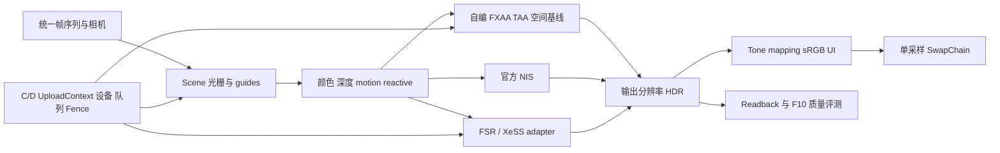

# F 实验室架构与所有权

本工程把 **场景生成、资源管理、时域契约、重建算法、官方 SDK、显示和验收** 分开。它复用 C/D 的低层 D3D12 context，是独立于 H 人物 PT Demo 的光栅与重建实验室。后续接入 H 时，优先迁移稳定接口；不要把 H 的人物控制、动画或路径积分搬进这里的实验主循环。

## 1. 模块边界

|模块|拥有 / 负责|不应该承担的工作|
|---|---|---|
|C/D `UploadContext`|device、DIRECT queue、allocator、list、Fence、InfoQueue；提交与等待|算法参数、人物输入、某一家 SDK 模式决策|
|`gpu_resources`|纹理对象与宿主记录的资源状态、descriptor、读回、timestamp、窗口|猜测一张纹理的 motion 单位或历史是否有效|
|`Scene`|可控场景几何、光栅 PSO、上一帧变换与 guides 生成|在生成 motion 时悄悄混入 jitter；替 SDK 管历史|
|`temporal_contract`|像素/UV/jitter 约定、history 失效原因|自动提交 GPU 或销毁资源|
|`PostChain`|宿主 compute/raster pass 的绑定；自编算法与官方 NIS 接口|把自编双线性叫做 FSR/DLSS，或吞掉 SDK 失败|
|`SdkUpscaler`|官方 DLL/context、FSR/XeSS 参数转换、推荐尺寸查询与错误状态|拥有宿主 color/depth/output；擅自提交/等待宿主队列|
|`main.cpp`|统一帧状态、质量档、fallback 决策、资源重建、验收组织|实现 SDK 内核或把所有资源 API 再复制一遍|
|Python 验证|独立 CPU oracle、已读回数据分析、日志汇总|用 CPU 插值或图像处理冒充 GPU SDK 输出|

F.9 使用独立可执行文件和真实 FG swapchain：它的调度会引入生成帧、后台呈现与 UI 合成回调。把它与 F.10 离屏质量基线拆开，可以避免 Present 的节奏和 callback 生命周期偷偷改变重建比较条件。二者共享同一个固定版本 FidelityFX 下载目录，源码与 context 各自独立。

## 2. 一帧中的数据顺序

1. 主循环确定真实 `frame/time`、相机与物体变换、内部和输出尺寸。所有方法使用同样的真实帧编号和 Camera Cut；第 60 帧切换相机。投影宽高比固定为输出宽高比，内部尺寸的整数舍入只影响采样格点，不能改变视锥。
2. history validity 检查首帧、相机切换、尺寸等失效原因；需要时设置 reset。jitter 只影响当前投影采样，motion 来自无 jitter 前后变换。
3. Scene 写入颜色与 guides。MSAA 的颜色/深度 sample count 一致；要显示时显式 resolve 到单采样资源，Flip SwapChain 永远单采样。
4. 宿主将需要的输入转为读取态、输出转为 UAV，再调用选定重建模块。FSR/XeSS 明确使用 `NON_PIXEL_SHADER_RESOURCE`，不是让 adapter 猜 `Texture::state`。
5. SDK 返回只表示命令录制成功。它可能覆盖 root signature、PSO 和 descriptor heaps；后续宿主 pass 重新绑定自己的状态。
6. 重建结果保持线性 HDR。教学TAA内部历史保持抖动网格，另调UnjitterCS写入独立稳定输出纹理；稳定图不回灌历史，该pass计入重建成本。质量读回在 tone mapping / UI 前进行；显示时再 tone mapping、sRGB 编码，并叠加输出分辨率 UI。
7. 提交命令，Fence 完成后才读取 Readback、复用 allocator、替换或销毁资源。当前验收逐批同步，便于验证；商业引擎通常使用多帧资源环和延迟回收。

资源状态转换描述“接下来如何访问”；Fence 描述“之前的 GPU 工作是否完成”。它们不能互相代替。UAV barrier 也不能当作 CPU 等待。

## 3. 时域数据契约

|数据|宿主定义|适配规则|
|---|---|---|
|颜色|内部尺寸线性 HDR RGBA16F；尚无 UI|FSR HDR flag；XeSS 默认 HDR；保持曝光一致|
|深度|实际 D3D 常规 0..1，近 0 远 1|R32_TYPELESS 资源包装给 FSR 时使用 R32_FLOAT SRV 解释；不打开 reversed/infinite flags|
|TAA motionDepth|RGBA32F：previous-current UV、当前/前帧线性 Z|自编 TAA oracle 使用，不直接当厂商 depth 传入|
|SDK velocity|RG16F：current→previous，内部像素单位，无 jitter|FSR `motionVectorScale=1`，XeSS low-res `velocityScale=1`|
|jitter|像素几何偏移，x 右、y 下|投影注入 `(+2jx/W,-2jy/H)`，SDK 传 `(jx,jy)`；FSR相位数用官方query，XeSS至少8×倍率²并取上整|
|预曝光 P|输入颜色已经乘过的正数，当前为 1|FSR `preExposure=P`；XeSS 固定曝光 E=1 时 `exposureScale=1/P`|
|reactive|当前透明压力区域的教学 mask|FSR 可消费；XeSS RPM 另有无 jitter 与初始化 flag 契约，基线未开启|

TAA 的 linear Z 与 SDK 的设备深度不是同一种数据。数据布局和数据含义通过不同字段明确，避免“都是一张 R32 纹理”就互换。

## 4. SDK 生命周期和错误出口

`SdkUpscaler::Initialize` 接收 device、SDK 种类、质量档、输出尺寸、maxRender 和依赖目录。宿主仍拥有 device；context 与已加载 DLL 由 adapter 持有。context 创建描述链存为成员，避免把需要存活的描述引用悬空。

FSR 预载指定目录的官方 effect，再加载 loader；这解决 loader 延迟查找与 exe 不同目录的问题。XeSS 从指定路径加载 `libxess.dll`。所有函数指针核对导出名称，缺 DLL / 缺导出 / 创建失败都留下 Status；不返回一个假的“成功 FSR”去跑空间算法。

输出尺寸改变：宿主先 Fence → adapter Shutdown → 重建输出与 context → 首帧 reset。FSR 内部 DRS 在最大尺寸以内逐帧更新 `renderSize`；XeSS 的允许范围属于特定质量档，需要官方查询，不能直接套用 FSR 倍率。

初始化不可用时，主序列明确标记 `fallback` 并走空间路径；完整验收要求官方模式都成功，不能让 fallback 混入 SDK 性能表。已经初始化后的 dispatch 失败则中止该次验收，当前未实现部分命令录制后的安全恢复；不能将初始化回退能力误称为任意运行时错误都能自动回退。严重 D3D device removed 与一般 SDK 不可用不同，不能靠继续发命令恢复。

## 5. 验证分层与测量边界

|层次|独立证据|能证明什么|
|---|---|---|
|数学约定|`verify_sdk_contracts.py`、`audit_temporal.py`|重投影方向、像素/UV、jitter、曝光与失效规则|
|Shader oracle|固定 CPU 输入 → 实际 GPU shader → 读回比较|给定有限用例的数值实现，与有意错误变体的差异|
|SDK probe|真实 device/context、推荐尺寸、resize 生命周期、缺 DLL|运行时确实可加载、版本和资源生命周期合理；不证明质量|
|质量序列|19 方法 × 120 帧、固定场景与有限参考|单帧与时域误差、显露/粒子等 ROI、Camera Cut 行为|
|成本|独立 `bench` GPU timestamp|离屏场景与重建 GPU 成本；不包含真实显示与输入延迟|
|帧生成|官方 GPU 输出、真实/生成帧日志、后置 UI、ETW 与 DXGI|插值与调度发生，显示事件可观察；不是光子延迟真值|

F.10 的 `reference` 是横纵各 4× 光栅后做 4×4 box，只有 16 个有限样本/输出像素；高频纹理和 alpha 边缘仍可能欠采样。ROI 依赖 no-AA 单采样 guide，边界分类有误差。误差时间差衡量重建误差如何随帧变化，不直接等于人眼感知闪烁。

每个 SDK 的实际 render/output 尺寸必须进报告；同名 Quality 档可能工作量不同。图像验收开启 Debug/读回，性能验收关闭这些开销，两组数字不得混为同一次测量。

## 6. 依赖与迁移

下载位置、版本和许可见 [README](README.md) 与 [SDK 清单](sdk_manifest.json)。第三方源码/二进制/模型位于忽略目录，不纳入个人仓库源码提交。课程结果保留小型数值摘要，大量原图/浮点序列可按命令重新生成。

若将来接 H：`SdkFrame` 的资源输入与生命周期可以复用，但 motion 必须来自实际上一帧蒙皮/相机变换，depth 来自同一可见性定义，reset 必须串联 H 的角色、镜头和尺寸事件，透明 reactive 要进入材质管线。先在相同输入上验证，再讨论异步重叠和多帧优化。
