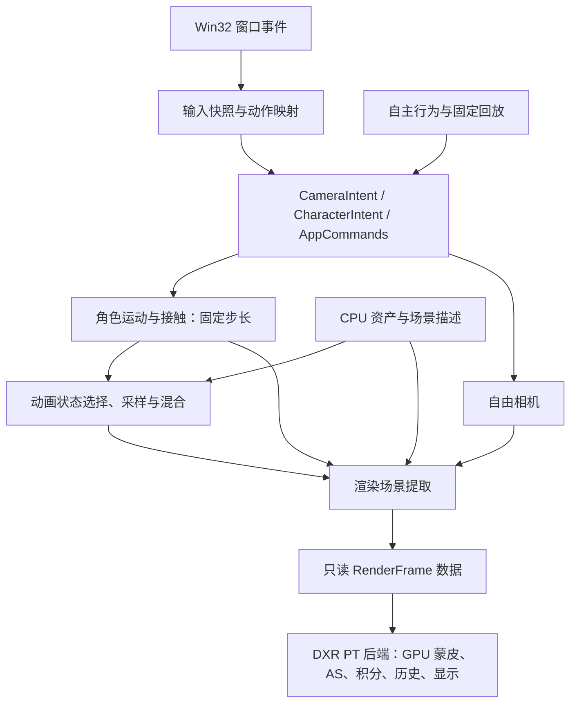

# H 阶段小型渲染器：模块、接口与所有权

2026-10-21：根据学习者要求，H1–H7 按模块化小型渲染器整合。课节是学习与验收顺序，模块是长期代码边界；一个课节可以修改多个模块，但不能因此把实现集中到课节 main 中。

## 1. 单向数据流

输入不直接修改 GPU 或骨骼。人物运动不调用窗口 API。动画采样不负责地面接触。渲染器不知道按了 W、人物为什么进入 Jump，也不决定落地时刻。App 负责初始化、固定步调度、场景提取与模块调用顺序。

## 2. 目录与职责

| 模块 | 职责 | 不承担的职责 | 当前状态 |
|---|---|---|---|
| `src/core/` | 自有数学值类型、后续句柄与时间定义 | 文件导入、OS 与 GPU API | 数学类型已落地 |
| `src/assets/` | 文件加载、许可/来源外部清单、导入库适配、CPU 资源所有权 | 动作播放、GPU 提交 | 角色导入已独立 |
| `src/animation/` | Clip、Skeleton/Skin 数据，局部姿势采样/混合、骨骼层级、蒙皮矩阵、CPU 参考 | 玩家输入、角色碰撞、CUDA 调度 | H2 核心已实现，公共接口使用项目类型 |
| `src/input/` | 窗口输入快照、按下/释放/保持语义、焦点和鼠标捕获，动作映射 | 世界运动与动画播放 | 已实现，窗口事件与焦点测试通过 |
| `src/simulation/` | CharacterIntent、固定步长、速度/重力/接触、角色状态机；相机运动模型 | 文件导入、AS、Present | H3/已实现，窗口事件与焦点测试通过 |
| `src/render/` | 帧数据契约、GPU 资源和渲染执行 | 游戏决策与按键含义 | 帧契约和后端已整合 |
| `src/render/cuda/` | GPU 蒙皮执行、共享缓存写入；实现层持有 CUDA 对象 | 选择动作、角色状态转换 | 已实现并经过数值/显存检查 |
| `src/render/dxr/` | BLAS/TLAS、PT、灯光采样、历史、降噪、显示与帧资源 | OS 输入和角色行为 | 已实现并通过数值/图像检查 |
| `src/app/` | 组合模块、加载配置、主循环、暂停/单步/退出 | 把算法实现塞入 main | 已实现，300帧窗口验收通过 |
| `tests/` | 独立数值、负对照、回归及无窗口验收入口 | 生产应用的核心实现 | H1–H7验收入口已实现 |

不为尚不存在的需求搭建通用 ECS、插件系统或跨平台 RHI。当前 DXR 是唯一渲染后端，优先用清晰的具体模块和数据结构；实际出现替换需求再引入抽象接口。

## 3. 接口约定

以下为实际接口契约；其中动画播放状态封装在AnimationPlayer内部：

- `InputSnapshot`：当前窗口内的保持状态、边沿事件、鼠标位移和焦点；一个渲染帧收集一次。丢失焦点清空保持状态并释放捕获。
- `CharacterIntent`：期望水平运动、奔跑意图、一次性起跳请求。默认来源是自动行为/回放，未来玩家输入也可产生同一种意图；WASD 首版仍映射给相机。
- `CharacterState`：仿真位置、速度、朝向、是否接地、运动状态及状态时间。固定步推进，独立于渲染帧率。
- `AnimationPlayer`：当前/目标动作、播放时间、混合进度；由人物状态选择动作，但动画片段不决定真实世界落地。
- `Pose` / 骨骼 palette：动画模块输出的值数据；不持有 CUDA 指针或 D3D12 资源。
- `RenderFrame`：相机、角色整体变换、骨骼数据、光源缩放、场景/照明版本和历史控制。静态场景与材质在构造时传入后端，当前没有每帧材质编辑接口。提交后它引用的数据需复制到后端帧槽或保持到对应 Fence 完成。
- `RendererStats`：耗时、帧号、资源/历史状态和诊断。应用可展示，不能反向让渲染器操控角色。

渲染场景提取负责把领域数据转成后端需要的布局，而不是让人物控制器填 D3D12 descriptor。场景数据和显存资源分开：资产句柄/CPU 值描述可以共享，GPU 创建、状态转换和回收统一归渲染后端。

## 4. 一帧如何组织

1. App 收集窗口事件，构造输入快照和应用命令。
2. 按累积时间执行零到多个固定仿真步；每个起跳边沿只消费一次，不因一个渲染帧补跑多个仿真步而重复触发。
3. 相机根据独立意图更新；人物状态机与动画状态按约定推进。暂停时停止仿真，但相机仍可移动；单步恰好推进一个固定步。
4. 提取不可变的帧数据，确定场景是否变化。曝光属于显示设置，不影响线性积分历史。
5. 渲染后端取得可复用帧槽，上传 palette，调度 CUDA 蒙皮与外部 Fence，再更新动态 BLAS/TLAS。
6. DXR 路径追踪、动态历史处理、降噪和显示，最后提交/Present，并保存资源释放所需的 Fence。

先建立同步正确基线，再扩展在途帧；同步基线也通过同一帧数据契约调用，不能让业务模块用 CPU 等待偷偷管理 GPU。上一帧姿势和几何归渲染历史/帧槽保存，不靠读取正在被动画模块改写的数组获取。

## 5. 构建边界与验收

H 阶段有独立 `CMakeLists.txt`，由现有共享工程通过 `add_subdirectory` 接入，避免把所有新增 target 堆进旧课工程。

- `h_animation` 只依赖 CPU 场景值类型与核心数学；不链接 Assimp、CUDA、D3D12。
- `h_character_assets` 私有依赖 Assimp/现有导入实现，输出自有数据，不向公共头文件泄漏 `aiScene*`、`aiQuaternion` 等类型。
- `h_skin_cuda` 是 GPU 执行库；CUDA 头文件只出现在该后端和显式 GPU 验收入口。
- `h_asset_probe`、`h_animation_test` 是测试程序，不是最终应用模块。
- `h_simulation` 已能在无窗口、无 GPU 的测试进程运行；输入回放与真实输入走同一意图接口。

架构变更必须重跑受影响的已有数值检查。目录分层只是外观，编译依赖、数据所有权和调用方向才是实际边界。

## 6. 本次实现的明确边界

当前单帧同步，Render返回前GPU完成，因此应用快照可安全释放；并未实现多帧并行。WindowDisplay暂由DXR后端持有，通过借用NativeWindow给输入适配器接线；窗口平台宿主尚未单独拆成服务。仿真/动画仍完全不依赖窗口和GPU。时域滤波是有界、有偏教学实现，金属/光滑表面拒绝历史；PT着色使用几何法线，没有切线/法线贴图。角色只有平面接触，无障碍碰撞、导航或自动跟拍。上述限制不改变模块调用方向，但不能称作商业引擎能力。

## 7. 画质修正后的接口（2026-10-21）

RenderFrame新增skyEnabled、skyIntensity、smoothNormals，仅描述渲染配置；应用JSON控制分辨率和采样，不由渲染后端读取文件。presentation布景、展示相机和圆周意图由App装配，旧小尺寸黑背景测试保留。天空shader独立成模块且同时服务主射线、NEE和反射/间接路径。当前已有插值法线着色，仍无切线/法线贴图；前节几何法线限制是修正前状态。
