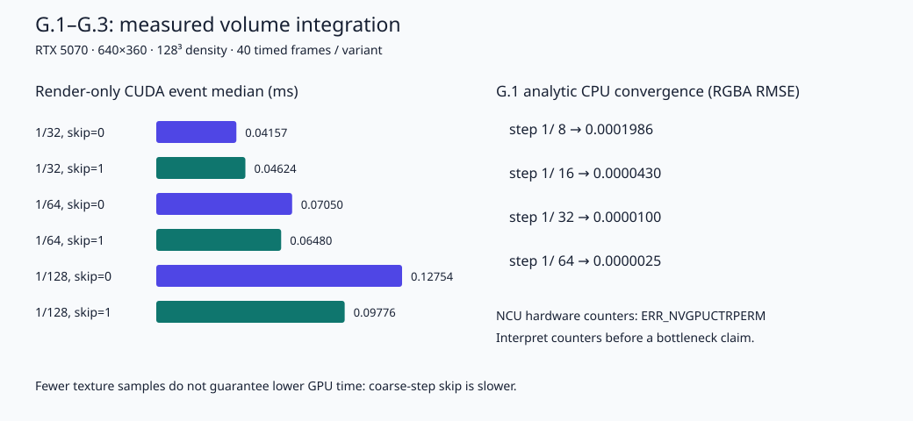

# G.3 体渲染的步长、跳空与性能实测

本节目标：把“减少了很多采样”与“GPU 真的变快”分开验证，同时理解误差来自哪里。2026-10-22 已完成固定场景六种配置的 CUDA event 计时、采样统计和参考图误差。

**本轮硬件计数器分析按用户明确授权略过。** 实际 Nsight Compute 尝试返回 `ERR_NVGPUCTRPERM`；用户随后授权跳过这一块、保留已有计时并明确标记。没有修改驱动权限设置，也没有用 event 时间冒充硬件计数器或编造瓶颈归因。证据见 [ncu_basic.csv](../../sandbox/d3d12/neural-rendering/results/g3/ncu_basic.csv) 与 [profiler_status.json](../../sandbox/d3d12/neural-rendering/results/g3/profiler_status.json)。

共享工程：[neural-rendering](../../sandbox/d3d12/neural-rendering/README.md)。[volume.cu](../../sandbox/d3d12/neural-rendering/src/volume/volume.cu) 第 30 行开始选择 occupancy 跳空，第 94 行开始构造保守网格；[volume_validate.cu](../../sandbox/d3d12/neural-rendering/tests/volume/volume_validate.cu) 第 117 行开始固定相机评测。图表生成脚本是 [report-volume.py](../../sandbox/d3d12/neural-rendering/tests/volume/report-volume.py)。

## 1. 先区分成本来源与误差来源

最直接的成本模型是

\[
\text{总成本}\approx\text{遍历成本}+\text{查询次数}\times\text{每次场查询成本}+\text{合成成本}.
\]

这是帮助选择实验的模型，不是对 GPU 时间的精确线性预测。GPU 还有调度、缓存、分支、并发和固定启动成本；减少查询次数后，新增的跳空逻辑可能成为更大的一项。

误差也有不同来源：

|来源|本课如何隔离|
|---|---|
|把连续密度存成 128³ 网格的表示误差|G.1 用解析函数；G.2/3 固定同一离散场|
|射线步长产生的求积误差|保持相机/场不变，只改 step|
|硬件三线性过滤的有限精度|G.2 与 CPU 手写三线性比较|
|提前终止丢弃尾部贡献|G.3 参考关闭提前终止|
|跳空误判|同一个 GPU 积分器开关 skip 逐像素比较|
|抖动|固定 seed，单独检查 skip 等价性|

如果同时换相机、提高分辨率、修改密度或曝光，就不能仅凭图像变好把效果归因于“更小步长”。

## 2. 固定步长、段内抖动与预乘 Alpha

固定中点求积使用 `t_i=begin+(i+.5)*delta`。相邻像素的采样层排列可能相似，复杂高频密度场里会形成可见条带。抖动把中点 `.5` 改成像素哈希生成的 `xi∈[0,1)`：

\[
t_i=begin+i\Delta+\xi\Delta.
\]

本课每条射线用同一个 `xi` 保持整条射线的格点间隔，只在最后的短段使用实际段长。抖动不改变 `delta` 的吸收厚度，不能写成 `alpha(sigma*xi*delta)`；它改变求积位置，不改变被代表的区间长度。

随机化可把规律误差变成噪声，但单帧噪声不自动消失。要得到稳定画面还需要多样本平均、时间重投影或其他重建方式。这个模块只提供确定性的 seed，不把 F 课程的历史累积暗中引入性能比较。G.2 验收使用 `seed=123`，抖动前后两条 GPU 跳空路径最大差仍为 0。

颜色累积继续使用线性预乘 Alpha：每段贡献 `T*alpha*c`，总 Alpha 为 `1-T`。屏幕显示时再次乘总 Alpha 会产生暗边；对预乘图像做插值或与背景合成时也应维持这个约定。

## 3. 提前终止的误差界与实际限制

如果在透射率为 `epsilon` 时停止，未积累的后续权重和最多是 `epsilon`。对颜色每通道都在 `[0,1]` 的场，漏掉颜色的绝对值不超过 `epsilon`；Alpha 也最多缺少 `epsilon`。

HDR 颜色若上界为 `M`，相应颜色界是 `epsilon*M`。若存在非常亮而很薄的发光源，仅凭 `T<.001` 不足以保证感知误差小。商业引擎可能结合亮度范围、路径重要性和专门的终止规则，本课选择有界的线性源颜色以便明确验证。

数值上继续使用 `-expm1f(-sigma*dt)`。`T` 与颜色保持 float；G.1 的中心射线额外使用独立 double 解析验证，而不是用更低精度的 GPU 数值去给自己作“精确参考”。

## 4. Occupancy grid 到底存什么

**Occupancy grid（占用网格）** 是比原场更粗的空间索引，记录某个区域是否可能贡献非零密度。这里把 128³ 场对应的世界盒划成 16³ 个等大 cell，每个 cell 一字节：0 表示可证明为空，1 表示需要采样。

它不等于 CUDA block，也不是神经网络的 occupancy rate；三个名称都可能含“占用”，但指向不同对象。

本课保留完整 128³ 稠密 array，粗网格只是帮助减少查询次数，**没有减少密度场存储量**。数据有效载荷为：

```text
128³ × sizeof(float) = 8,388,608 bytes
16³ × sizeof(uint8)  =     4,096 bytes
合计                 = 8,392,704 bytes
```

这只是有效载荷下界，CUDA array 可能有实现相关的对齐；不能直接把它叫作进程显存峰值。输出、统计、上下文和 D3D12 资源另有占用。

### 为什么不能只检查 cell 内的体素

三线性采样会读取最多八个邻点；靠近 cell 边界时会读取相邻 cell 的体素。若只看本 cell 中心体素，可能把“内部样本为零但边上插值非零”的区域误判为空。

因此 CPU 构建 occupancy 时扩展一个体素的 halo。**Halo（边界邻域）** 就是为了局部运算而额外保留的邻接数据。只有覆盖区域及其插值邻域所有密度都严格为 0，才标空。

这是一种保守判定：可能多保留一些其实没有贡献的位置，影响速度，但不能错误丢弃非零颜色。我们没有用“密度小于某阈值算空”的近似；如果将来引入阈值，就应另外衡量误差，不能继续声称逐位等价。

## 5. 怎样跳过空区域而不改变采样格点

找到当前采样点所在的粗 cell 后，沿射线计算离开它的最近边界。对轴 `a`：

\[
d_a=\frac{b_a-p_a}{v_a}.
\]

`b_a` 根据射线方向选该轴 cell 的前向边界，只取非负候选距离；平行轴不参与最小值。三轴候选中的最小值就是离开当前 cell 的距离。

直觉上可“把 t 移到边界”，但这样会重启后面的采样相位：原本的中点网格与新边界通常不对齐，即使跳过的是严格空区域，后面的非零采样点也变了。

本课保持 `begin` 与整数索引 `k` 不变，直接求下一个允许的索引。对于完整段的采样偏移 `xi`：

\[
k_{next}=\left\lceil\frac{t_{exit}-begin}{\Delta}-\xi\right\rceil.
\]

同时强制至少前进一个索引，避免浮点边界误差导致无限循环。最后不足一步的段仍使用其真实段长，统计时把这段记为一个区间。

由于粗网格判定保守、跳转保持采样相位，开关 skip 后实际参与积分的非零样本一致。G.2 在普通网格、33³ 非整除网格和带抖动条件下都验证了这一点。

## 6. 分块加载与本课边界

进一步的**分块加载**是把场分成 bricks，仅在显存中保留当前需要的块，并用页表或索引找到它们。它解决容量与传输问题，和“密度已经全在显存，只是跳过空区域”的优化目的不同。

要实现正确的分块加载，至少需要处理：块驻留状态、异步上传与使用的顺序、纹理过滤的边界邻域、缺块时的回退、缓存淘汰期间仍在飞行的 GPU 引用，以及随密度变化更新 occupancy 的时机。三线性过滤所需 halo 在这里同样重要。

本课讲清设计机制，没有把 8 MiB 的教学场改造成流式存储系统；源码中的 array 始终完整驻留。大体积引擎常使用稀疏层次、砖块缓存、视距层级与压缩，底层仍要处理相同的坐标、采样和同步约束。

## 7. 实测设计与结果

硬件是 RTX 5070，驱动 610.88，CUDA Runtime/Driver API 13.3，编译 `sm_120`。固定 `640×360`、相机 `(0,0,-3)`、垂直视场 50°、128³ 密度球。每种配置先预热 8 帧，再独立测 40 帧；报告 CUDA event 中位数，事件只包住渲染 kernel，不包含 CPU 参考、图像读回和统计缓冲输出。

参考图仍使用同一 GPU 三维纹理场，但步长为 `1/1024`、关闭提前终止，隔离表示差异。误差比较线性预乘 RGBA 的全部四个通道。计时记录包含 min/max，保留调度和频率波动，不挑最漂亮的一次。

|步长|跳空|GPU 中位数 ms|RGBA RMSE|每输出像素纹理查询数|每像素跳过区间数|
|---:|---|---:|---:|---:|---:|
|1/32|关|0.041568|7.16777e-5|21.2046|0|
|1/32|开|0.046240|7.16777e-5|3.9662|17.2385|
|1/64|关|0.070496|8.04697e-5|42.1136|0|
|1/64|开|0.064800|8.04697e-5|7.9022|34.2115|
|1/128|关|0.127536|8.54671e-5|83.9205|0|
|1/128|开|0.097760|8.54671e-5|15.7604|68.1601|

所有配置中，盒命中像素比例为 `60.3125%`，提前终止占**全部输出像素**的 `2.3385417%`。平均纹理查询数同样以全部像素为分母，包含未命中像素的 0 次，不能直接当作“每条命中射线的长度”。所有配置的最大 RGBA 误差约 `0.00099504`。



机器可读结果：[quality_performance.csv](../../sandbox/d3d12/neural-rendering/results/g3/quality_performance.csv)，环境与测量约定：[metadata.json](../../sandbox/d3d12/neural-rendering/results/g3/metadata.json)。

### 这组结果支持什么结论

在三种步长下，跳空都把纹理查询次数降低约 81%。但 `step=1/32` 时，GPU 时间从 `0.041568` 上升到 `0.046240 ms`；这说明新增判断/边界计算的成本在这组实验中超过了省下的查询收益。`1/128` 时则下降到 `0.097760 ms`，约减少 23.35%。

这支持“减少查询数不保证更快”以及“这个场景的小步长配置从跳空中获益”。它不能单独证明纹理单元、带宽、分支发散或算术吞吐谁是硬件瓶颈；这些需要计数器和进一步受控实验。

### 为什么这里步长更小，RMSE 反而略升

计时变体使用 `T<.001` 提前终止，而参考关闭终止。小步长通常更接近阈值时才停止，留下的尾部 T 更接近 `.001`；粗步长可能一次越过阈值，剩余尾部更小。此时终止误差已盖过求积误差，减小步长并不会继续降低最终 RMSE。

G.1 在两边都关闭终止时，误差随步长减半明显下降；两组实验回答不同问题，并不矛盾。后续质量调节要同时考虑步长与终止阈值，而不能只不断提高采样数。

## 8. Nsight Compute 的角色与本轮省略

计数器原计划用于读取 SM/内存吞吐、实际 occupancy、活跃线程和采样路径等信息，结合源代码定位成本。**Occupancy（硬件驻留率）** 在这里是 SM 上驻留 warp 数相对上限的比例，与前文的空间占用网格无关；高 occupancy 也不自动等于高性能。

本机真实执行过：

```powershell
ncu --target-processes all --set basic --launch-count 1 --csv `
  --log-file learning/sandbox/d3d12/neural-rendering/results/g3/ncu_basic.csv `
  learning/sandbox/d3d12/neural-rendering/build/volume/volume_validate.exe `
  learning/sandbox/d3d12/neural-rendering/results profile
```

工具连接进程后报告当前用户无权访问 GPU Performance Counters。本轮按照用户指令略过，不修改全局权限设置、不把未取得的数值写成 0。以后如恢复计数器实验，应把 replay、cache control、时钟和 kernel 实例也记录下来；Nsight replay 的测量环境与本节未被 profiler 包裹的 CUDA event 时间并不完全相同。[Nsight Compute Profiling Guide](https://docs.nvidia.com/nsight-compute/ProfilingGuide/)

## 9. 复现、自测与答案

从仓库根目录执行：

```powershell
& learning/sandbox/d3d12/neural-rendering/tests/volume/verify-volume.ps1 -SkipProfiler
```

验证脚本重新构建 `sm_120` 核心、运行 G.1/G.2 正确性和 G.3 计时，随后运行 memcheck/synccheck，并从 CSV 生成 SVG。为了保持比较可解释，运行时不要同时训练 NeRF、跑另一个 GPU benchmark 或启动重负载游戏。

1. **跳空少了 81% 查询，为什么没有快五倍？** 查询只是总成本的一项；遍历和跳空自身成本仍在，GPU 时间还受到调度等因素影响。当前数据只支持实际测得的变化。
2. **occupancy grid 能否直接节省密度场显存？** 本课不能。它是额外索引，完整稠密场仍驻留；减少存储需要真正的稀疏/分块表示。
3. **把密度小于 `.01` 的 cell 直接跳过还会逐位等价吗？** 不保证，因为这些区间可能仍有非零光学厚度；应定义误差预算并验证。
4. **不启用计数器，能否说“此 kernel 被显存带宽限制”？** 不能仅凭现在的时间与采样数作这个判断。本轮保留可重复现象，硬件归因按用户要求省略。

下一节把“查询密度与颜色”的来源从三维纹理换成神经网络。G.1 的积分与相机约定继续复用，训练、网络查询与最终显示的生命周期则必须重新明确。
